# 📁 Expenses - Exercises XP

Part of the project for Exercises XP.

## Contents

- [`CategorySummary.jsx`](CategorySummary.jsx)
- [`ExpenseForm.jsx`](ExpenseForm.jsx)
- [`ExpenseList.jsx`](ExpenseList.jsx)
- [`expensesSlice.js`](expensesSlice.js)

---

## 👤 Author

**Kevin Cusnir 'Lirioth'**  
Repository: [Fullstack2026](https://github.com/LiriothTeltanion/Fullstack2026)  
Week 9 Day 5 - Redux Mini-project - Exercises XP
