# 🥇 Exercises XP Gold

<div align="center">




</div>

A five-question quiz about Redux itself, with 15 seconds per question. The whole game (current question, chosen answers, timer, finished flag) lives in one slice.

## ▶️ How to run

```bash
npm install
npm run dev
```

## 🎯 The challenge

1. **Quiz slice.** `optionChosen` saves the answer once, `nextQuestion` moves on (or sets `finished` on the last question), and `restarted` returns the initial state.
2. **Timer.** `Quiz` starts a `setInterval` that dispatches `tick` every second. At 0 the answer is stored as `null`, which counts as wrong.
3. **Score selector.** `selectScore` compares each stored answer with the right option index.
4. **Feedback.** After answering, the right option turns green and a wrong pick turns red. The last screen shows the score and a Play again button.

## 🧠 What I learned

- The interval lives in a `useEffect` whose cleanup calls `clearInterval`, so the timer stops as soon as the question is answered
- Storing `null` for "no answer" and leaving `undefined` for "not reached yet" let me tell the two cases apart
- Returning `initialState` from `restarted` is the simplest full reset in a slice
- The score is never stored: it is calculated from the answers every time

---

## 👤 Author

**Kevin Cusnir 'Lirioth'**  
Repository: [Fullstack2026](https://github.com/LiriothTeltanion/Fullstack2026)  
Week 9 Day 5 - Redux Mini-project - Exercises XP Gold
