# 📁 Quiz - Exercises XP Gold

Part of the project for Exercises XP Gold.

## Contents

- [`Quiz.jsx`](Quiz.jsx)
- [`quizSlice.js`](quizSlice.js)

---

## 👤 Author

**Kevin Cusnir 'Lirioth'**  
Repository: [Fullstack2026](https://github.com/LiriothTeltanion/Fullstack2026)  
Week 9 Day 5 - Redux Mini-project - Exercises XP Gold
