# 🥷 Exercises XP Ninja

<div align="center">




</div>

A three-column Kanban board (To do, Doing, Done). Cards move between columns with arrow buttons, and a custom middleware saves the board to `localStorage` after every board action.

## ▶️ How to run

```bash
npm install
npm run dev
```

Add a card, move it to **Doing**, and reload to see it in the same column.
If a previous save has missing columns or stale references, the board restores
each readable card once and puts unassigned cards in **To do**. Opening the
page leaves the saved copy untouched. The next board edit saves the restored
layout. Run `npm test` to check these recovery cases without a browser.

## 🎯 The challenge

1. **Board shape.** `cards` is a lookup by id and `columns` keeps only ordered id lists, so a card is stored once.
2. **Reducers.** `cardAdded` (to "To do"), `cardRenamed`, `cardDeleted` (removes the id from every column), `cardMoved` with `direction: -1 | 1`, and `boardReset`.
3. **Persistence middleware.** `persistBoard` runs `next(action)` first, then saves the board when the action type starts with `board/`. `loadBoard` fills `preloadedState`.
4. **Fewer re-renders.** `Column` passes `shallowEqual` from `react-redux` to `useSelector`, because `selectColumnCards` builds a new array every time.

## 🧠 What I learned

- With ids in the columns, moving a card is just "remove the id here, push it there", and the card object never moves
- Running `next(action)` before saving means the middleware stores the new board, not the old one
- `useSelector` accepts an equality function as its second argument, which fixed columns re-rendering when another column changed
- `cardMoved` ignores moves past the first or last column, so the reducer stays safe even without the disabled buttons

---

## 👤 Author

**Kevin Cusnir 'Lirioth'**  
Repository: [Fullstack2026](https://github.com/LiriothTeltanion/Fullstack2026)  
Week 9 Day 5 - Redux Mini-project - Exercises XP Ninja
