# 📁 Board - Exercises XP Ninja

Part of the project for Exercises XP Ninja.

## Contents

- [`Board.jsx`](Board.jsx)
- [`Column.jsx`](Column.jsx)
- [`boardSlice.js`](boardSlice.js)

---

## 👤 Author

**Kevin Cusnir 'Lirioth'**  
Repository: [Fullstack2026](https://github.com/LiriothTeltanion/Fullstack2026)  
Week 9 Day 5 - Redux Mini-project - Exercises XP Ninja
