# 📁 Products - E-commerce Product Filter

Part of the project for E-commerce Product Filter.

## Contents

- [`ProductGrid.jsx`](ProductGrid.jsx)
- [`productsSlice.js`](productsSlice.js)

---

## 👤 Author

**Kevin Cusnir 'Lirioth'**  
Repository: [Fullstack2026](https://github.com/LiriothTeltanion/Fullstack2026)  
Week 9 Remote Learning - Redux - Remote Exercise
