# 🧪 Remote Exercise - Movie Collection Organizer

<div align="center">




</div>

My movie list with Redux Toolkit. Movies have a title, year, genre, a 1 to 5 star rating and a watched flag, and the list can be filtered by genre and status and sorted three ways.

## ▶️ How to run

```bash
npm install
npm run dev
```

## 🎯 The challenge

| Piece | What it does |
|---|---|
| `moviesSlice` | `movieAdded`, `watchedToggled`, `movieRated` and `movieRemoved`, with four starting movies |
| `filtersSlice` | `genreFiltered`, `statusFiltered`, `sortChanged` and `filtersReset` |
| `selectVisibleMovies` | Filters by genre and status, then sorts by title, year (newest first) or rating |
| `selectStats` | How many movies are watched out of the total |
| `MovieForm` | Checks the title and the year (1888 to five years from now) before dispatching |
| `FilterBar`, `MovieList` | The three menus plus Reset, and the list with a rating menu per movie |

## 🧠 What I learned

- `toSorted()` hands back a sorted copy, so the selector never sorts the array that lives in the store
- Putting the compare functions in an object (`compare[sortBy]`) replaced a `switch` inside the selector
- `rating: b.rating - a.rating || a.title.localeCompare(b.title)` breaks ties by title in one line
- The form keeps the year as a string while typing and converts it with `Number()` only on submit

---

## 👤 Author

**Kevin Cusnir 'Lirioth'**  
Repository: [Fullstack2026](https://github.com/LiriothTeltanion/Fullstack2026)  
Week 9 Remote Learning - Redux - Remote Exercise
