# 📚 Exercises

The exercises for this day. None of them are done yet.

## Contents

- [`TodoListManager/`](TodoListManager/): Todo List Manager: to do (optional)
- [`MovieCollectionOrganizer/`](MovieCollectionOrganizer/): Movie Collection Organizer: to do (optional)
- [`EcommerceProductFilter/`](EcommerceProductFilter/): E-commerce Product Filter: to do (optional)

---

## 👤 Author

**Kevin Cusnir 'Lirioth'**  
Repository: [Fullstack2026](https://github.com/LiriothTeltanion/Fullstack2026)  
Week 9 Remote Learning - Redux - Exercises
