# 🧪 Remote Exercise - Todo List Manager

<div align="center">




</div>

A todo manager in the style of TodoMVC, built on one Redux Toolkit slice. Besides add, toggle and delete, it edits in place, filters the list, ticks everything at once and clears the completed todos.

## ▶️ How to run

```bash
npm install
npm run dev
```

## 🎯 The challenge

| Action | What it does |
|---|---|
| `todoAdded(text)` | Adds a todo with a `nanoid()` id |
| `todoToggled(id)` / `todoDeleted(id)` | Ticks or removes one todo |
| `todoEdited({ id, text })` | Saves the edited text (double-click or the Edit button) |
| `allToggled()` | Ticks every todo, or unticks them all when they are all done |
| `completedCleared()` | Removes the finished todos |
| `filterChanged(filter)` | `"all"`, `"active"` or `"completed"` |

`selectVisibleTodos` applies the filter and `selectCounts` returns `{ total, completed, active }` for the footer.

## 🧠 What I learned

- Keeping the filter in the slice next to the items means one selector can answer "what should be on screen"
- `allToggled` checks `every(...)` first, so the same button ticks everything or unticks everything
- Saving the edit on `onBlur` as well as on Enter covers the user clicking somewhere else
- An empty edit puts the old text back instead of saving a blank todo

---

## 👤 Author

**Kevin Cusnir 'Lirioth'**  
Repository: [Fullstack2026](https://github.com/LiriothTeltanion/Fullstack2026)  
Week 9 Remote Learning - Redux - Remote Exercise
