# 🧰 Features - Todo List Manager

The Redux slices, one folder per feature for Todo List Manager.

## Contents

- [`todos/`](todos/)

---

## 👤 Author

**Kevin Cusnir 'Lirioth'**  
Repository: [Fullstack2026](https://github.com/LiriothTeltanion/Fullstack2026)  
Week 9 Remote Learning - Redux - Remote Exercise
