# README Visuals

SVG illustrations shown in the repository READMEs. Every file listed in
[`visual_manifest.json`](visual_manifest.json) records its SHA-256 hash, dimensions,
alt text, motion behavior and privacy review; `npm run verify:visuals` checks them.

## Contents

- [`days/`](days/) — per-day overview maps, starting with Week 1 Day 1.
- [`ultimate/`](ultimate/) — the root README banner, twelve-week journey map and technology constellation.
- [`visual_manifest.json`](visual_manifest.json) — source and review data for each visual.
