# Tests

<div align="center">




</div>

Tests for this project.

## Contents

- [`js/`](js/)
- [`python/`](python/)

## Run

From the repository root:

```bash
python tests/python/test_circle.py
python tests/python/test_hangman.py
python tests/python/test_repository_layout.py
```
