# Js

JavaScript modules for this exercise.

## Contents

- [`math_helpers.test.mjs`](math_helpers.test.mjs)
- [`repository_health.test.mjs`](repository_health.test.mjs)
- [`typescript_syntax.test.mjs`](typescript_syntax.test.mjs)
