# Tools

<div align="center">




</div>

Scripts that keep the repository consistent. CI runs them on every pull request
(see [`.github/workflows/quality.yml`](../.github/workflows/quality.yml)).

## Contents

| Script | What it does | npm script |
|---|---|---|
| [`quality_gate.py`](quality_gate.py) | Whole-repository check: Python/JS/TS syntax, JSON, HTML, CSS, Markdown links, likely credentials, README coverage | `npm run quality` |
| [`validate_repository_structure.py`](validate_repository_structure.py) | Canonical paths, exact-case links, catalog consistency, private-data and secret safeguards | `npm run verify:structure:core` |
| [`refresh_structure_catalogs.py`](refresh_structure_catalogs.py) | Regenerates the exercise catalog, file inventory and tree in `reports/nova/` from the Git index | `npm run catalogs:refresh` / `catalogs:check` |
| [`validate_readme_visuals.py`](validate_readme_visuals.py) | README images: local assets, manifest hashes, alt text, motion and privacy rules | `npm run verify:visuals` |
| [`validate_display_titles.py`](validate_display_titles.py) | Icon-led display titles mapped to stable ASCII folder names | `npm run verify:titles` |
| [`learning_intake.py`](learning_intake.py) | Own-words exercise intake queue (add, next, import, validate) | `npm run intake` |
| [`run_node_tests.mjs`](run_node_tests.mjs) | Runs the Node test files under `tests/js/` | `npm run test:js` |
| [`check_typescript_syntax.mjs`](check_typescript_syntax.mjs) | TypeScript syntax check used by the quality gate | — |
| [`verify_eslint_baseline.mjs`](verify_eslint_baseline.mjs) | Checks that ESLint findings match the recorded curriculum baseline counts | `npm run lint:baseline` |

## Run

From the repository root:

```bash
python tools/quality_gate.py --repo . --strict
npm run verify:structure
npm test
```
